# gp-ard 核拆分的数据层证据（简明版）

> 本报告由外推方案/数据论证/ 下的工作产物整理而来，数据源为 dataset_same8/train.csv（2048 行，冻结划分 sdm374.same8.splits.2x5x3.frozen.v1）。
> 详细版（方法、公式、完整数字表、逐条局限）：[附录_完整分析.md](附录_完整分析.md)

## 一句话结论

**有数据支撑的**：三块分楼项占 90%（楼内 ΔR 的解释力是楼间的 **3.6 : 1**）；7 个长度尺度**按指标**定义（指标主效应 **62.6%** vs 楼主效应 12.8%，ℓ 与数据敏感性 **ρ = −0.955**）。
**没有数据支撑的**：三块**等权 1/3**（楼2 的重要性只有楼1 的 **13%**）；w = 0.1 **偏大**，数据支持 0 < w ≲ 0.1，最贴近的是 hp_wlearn 学到的 **0.043**。

## 数据长什么样

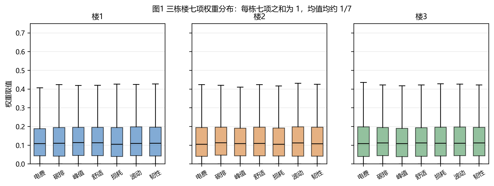

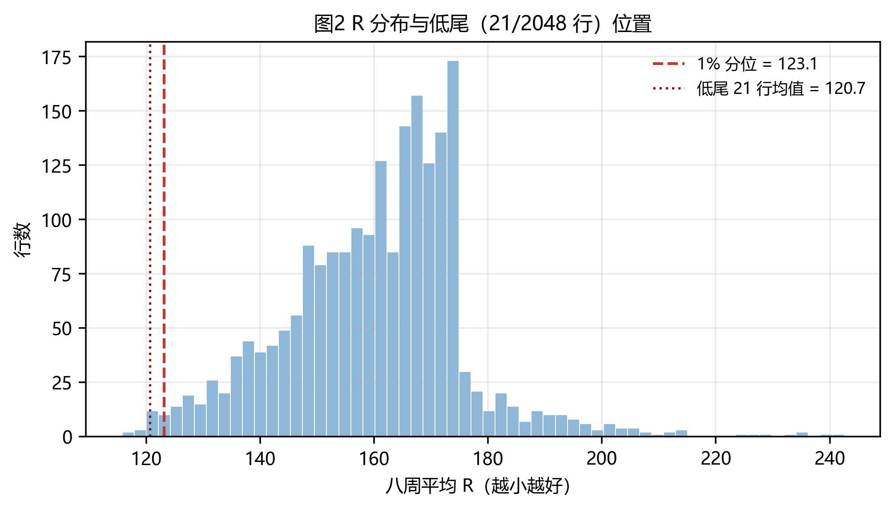

*每栋 7 维权重都为 1（单纯形），R 的 1% 低尾只有 21 行、且明显偏低。*

## A 楼内结构 > 楼间结构

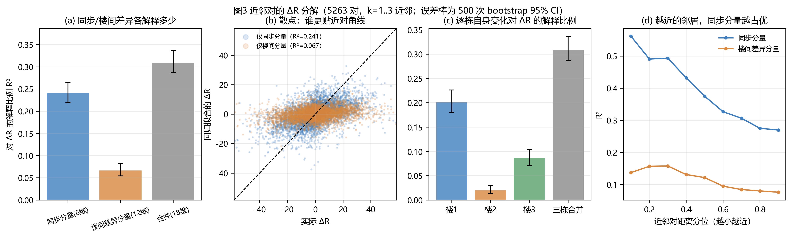

*近邻对 ΔR 里"三栋同步调整"解释 **R² = 0.241**，"楼间差异"只有 **0.067**，而"邻居有多远"几乎无关（R² = 0.0002）。*

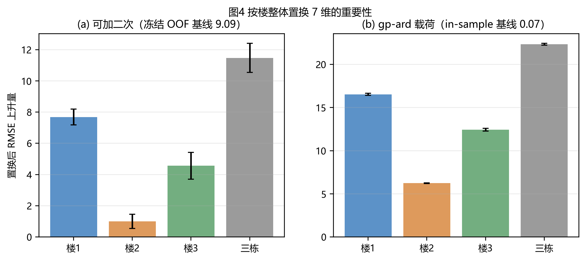

*整栋置换的误差上升：楼1 **+7.69**、楼3 **+4.56**、楼2 仅 **+0.99** —— 三栋都重要，但绝不等价。*

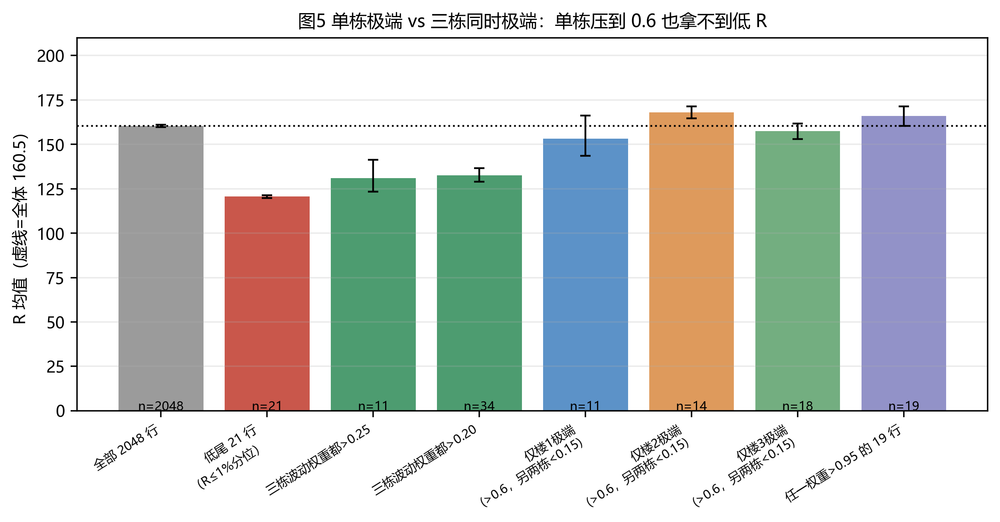

*只压一栋（另两栋 < 0.15）R 仍在 153–168，等于甚至高于全体均值 160.5；三栋同时偏高才降到 **131** —— 只压一栋没用。*

## B 7 个尺度按指标定义

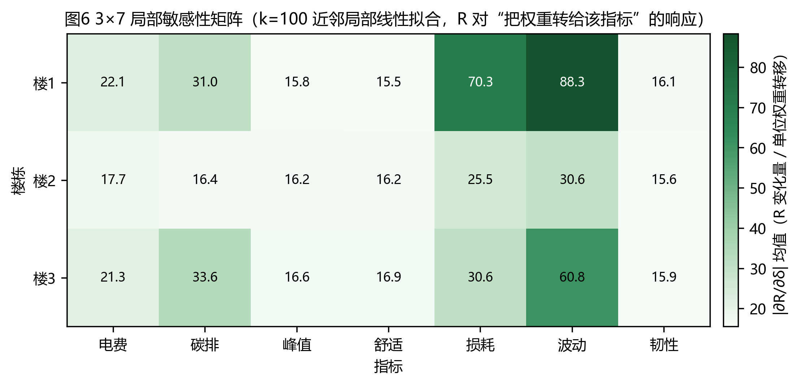

*3×7 敏感性矩阵：损耗、波动（尤其楼1）是明显的热点，峰值/舒适/韧性贴在同一"地板"。*

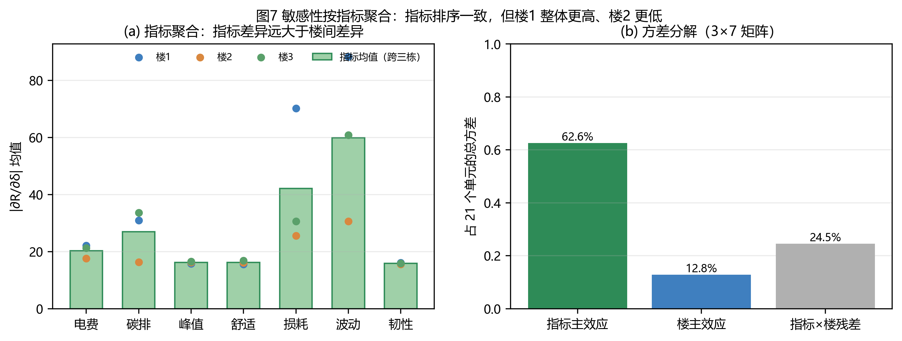

*指标效应占 **62.6%**、楼占 12.8%；三栋的指标排序 ρ = 0.82–0.86 高度一致。*

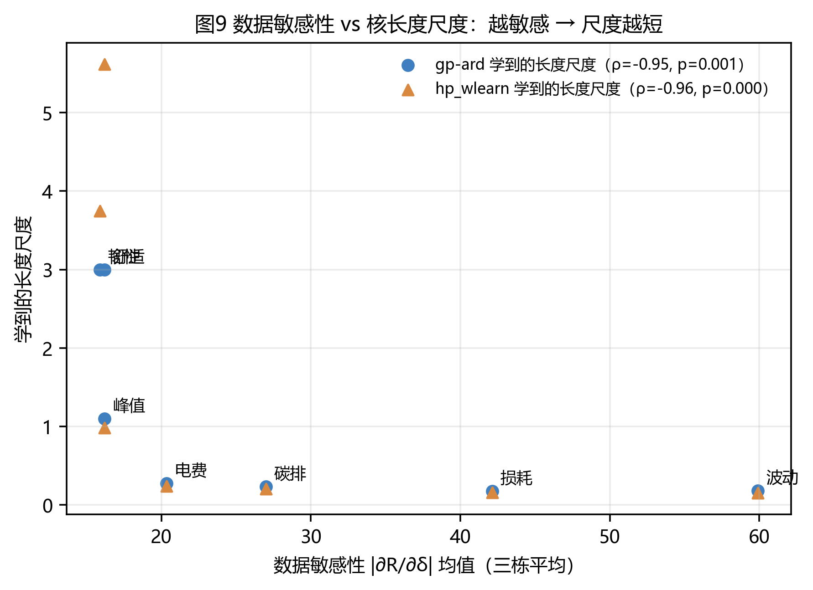

*学到的 ℓ 与数据敏感性几乎完全负相关：**ρ = −0.955**（p = 0.0008）—— 尺度确实在跟着指标走。*

## C 楼间交互弱但非零

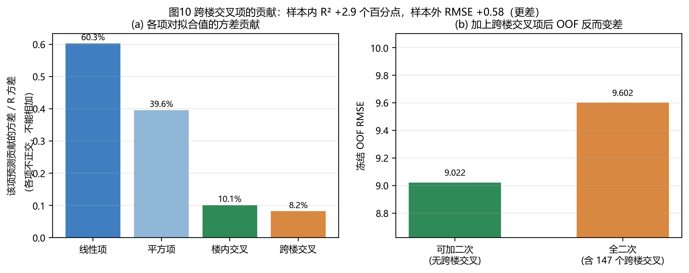

*147 个跨楼二次项只多解释 **ΔR² = 0.029**（随机项期望就有 0.021），样本外 RMSE 反而 **+0.58**（9.022 → 9.602，p = 0.007）。*

> **口径与来源（复算已核对）**：9.022 / 9.602 是 `外推方案/分楼搜索/results/oof_additive.csv`
> 的 `additive_quadratic` / `full_quadratic` 对 `actual` 的 RMSE，**按 2048 个唯一候选池化**
> （本机复算 9.0221 / 9.6016）。换成别的聚合口径数值会变：**逐折 10 折平均**为
> 9.0868 / 9.6598（`外推方案/数据论证/results/a_numbers.json` 的 `base_rmse` =
> 9.086772877412855）；若把逐折预测按 4096 条（同一候选计两次）再池化，会得到约 9.09 / 9.67
> （独立审计复算值 9.0929 / 9.6658 即属此口径）。三种口径结论一致（全二次更差 +0.57～0.58），
> **引用时请连同口径一起写**：本文所有 9.022 / 9.602 均指"2048 唯一候选池化"。

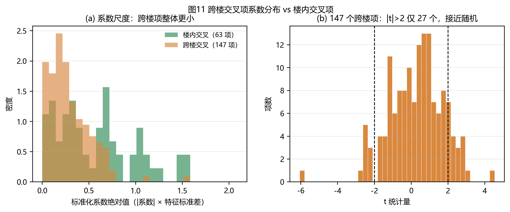

*跨楼项尺度只有楼内项一半，41% 落在 0 附近；但 **27/147** 达到 t 值大于 2（纯噪声期望约 7）—— 有一点信号，却钉不住。*

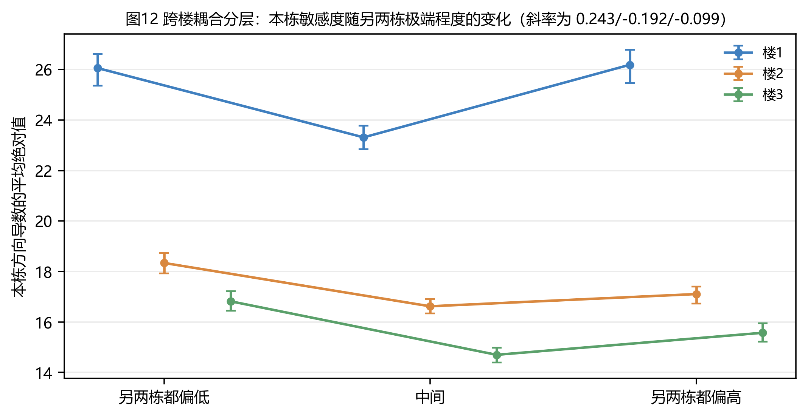

*按另两栋的极端程度分层，本栋敏感度只有 ±10% 的非单调起伏，两条独立路径方向还相反 —— 不是稳定的跨楼耦合。*

## 两个反例

**反例一：三块等权 1/3 不成立。** 楼1 : 楼2 : 楼3 的置换 ΔRMSE 是 **7.6857 : 0.9937 : 4.5599**（约 7.69 : 0.99 : 4.56），逐栋 R² 是 0.201 : 0.020 : 0.087。等权是"对称先验"，不是数据结论。

> 来源：`外推方案/数据论证/results/a_numbers.json` 的 `perm_additive_quadratic`
>（base_rmse 9.0868，5 次置换 × 10 折，逐折 RMSE 平均）；置换随机种子不同会有 **约 ±0.2～0.3** 的波动
>（独立审计用不同种子得到 7.895 / 0.985 / 4.482，仍远非等权），因此只应引用两位小数。

**反例二：w = 0.1 偏大。** 数据只能确定 0 < w ≲ 0.1；且 hp_wlearn（w = 0.043）整体 OOF 更好（5.114 vs 5.231）。但它的低尾 RMSE 更差（5.307 vs 4.767），而尾部恰是本项目的重点 —— 所以 10% 是保守上界，不是最优值。

## 局限

- 数据是 **Dirichlet 随机采样**，不是真实调度场景；无控制变量实验，所有结论都是相关性层面的。
- 低尾只有 **21 条**，尾部结论的统计功效很弱；21 维空间整体稀疏，稀疏区敏感性不稳。
- 跨楼交互**无法做反事实验证**（不能真去"只改一栋楼"再看 R），只能靠回归项与分层比较间接推断。
- 敏感性的绝对值随近邻数 k 变化（k=50/100/200 差 12–24%），只有排序是稳的（秩相关 0.999）。
