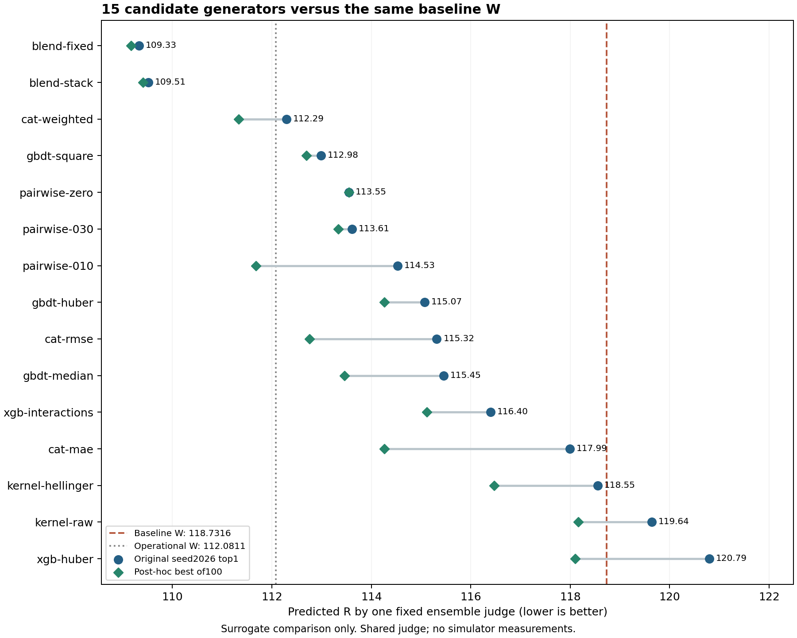

# All 15 candidate generators versus baseline — one fixed judge

**13 of 15 original seed2026 top choices have lower predicted R than the course baseline W**
under the same fixed full-data OOF-stacking judge. Baseline predicted R is **118.7316**.
The best original top choice is `blend-fixed` at **109.3303**,
a predicted reduction of **7.92%**.
The best post-hoc candidate is **109.1711** from the same generator,
`20261029-171301-optimize-method-blend-fixed-search2027`, rank1.
These are surrogate predictions; real-simulator confirmation was explicitly deferred by the user.

## What is held constant

[Protocol](../README.md) and script were committed before the batch at `fe7f882`.
The sole judge is `20261029-171251-train-method-blend-stack`, unchanged all-data fit, model seed2026.
It uses training-only OOF-learned convex XGBoost/CatBoost/HistGB weights and has previously passed the
matched model-seed audit. Its fitting and frozen-v32 evidence are in
[the method-study delivery](../../method_expansion/delivery/README.md).

The exact root `weights.json` is the baseline. All 1500 proposals from the 15 discovery methods are
retained at original precision: two optimizer seeds, 50 proposals each. No new search, projection,
rounding or filtering occurred. One **`sdm predict` batch of 1503 inputs** scored baseline, operational
W, best measured row and all proposals. Every point uses the same fitted predictor and feature order.
`provenance.json` records a clean `fe7f882`, judge model hash, data hash, packages and all input hashes.
`run_evidence.json` archives the judge and all 30 original optimizer configs/meta/metrics.

## Main comparison

All numbers below are **predicted R by that single judge**, lower is better. Delta = candidate minus
baseline; negative indicates a predicted improvement. The original-top1 column always uses optimizer
seed2026, rank1 chosen by the generator's own mean+proxy objective. It is never replaced by a better
point found using this judge. The best-of-100 column is explicitly **post-hoc reranking** by this judge.

| Candidate generator | Original top1, seed2026 | Delta vs baseline | Top1 reduction | Best of 100, reranked | Below baseline /100 |
|---|---:|---:|---:|---:|---:|
| blend-fixed | 109.3303 | -9.4013 | 7.92% | 109.1711 | 100 |
| blend-stack | 109.5113 | -9.2203 | 7.77% | 109.4107 | 100 |
| cat-weighted | 112.2918 | -6.4398 | 5.42% | 111.3298 | 100 |
| gbdt-square | 112.9842 | -5.7474 | 4.84% | 112.6915 | 100 |
| pairwise-zero | 113.5477 | -5.1840 | 4.37% | 113.5477 | 100 |
| pairwise-030 | 113.6109 | -5.1207 | 4.31% | 113.3310 | 100 |
| pairwise-010 | 114.5270 | -4.2046 | 3.54% | 111.6804 | 100 |
| gbdt-huber | 115.0705 | -3.6611 | 3.08% | 114.2596 | 100 |
| cat-rmse | 115.3162 | -3.4154 | 2.88% | 112.7603 | 100 |
| gbdt-median | 115.4549 | -3.2767 | 2.76% | 113.4585 | 98 |
| xgb-interactions | 116.3980 | -2.3336 | 1.97% | 115.1163 | 87 |
| cat-mae | 117.9885 | -0.7431 | 0.63% | 114.2574 | 76 |
| kernel-hellinger | 118.5549 | -0.1767 | 0.15% | 116.4735 | 46 |
| kernel-raw | 119.6413 | +0.9097 | -0.77% | 118.1642 | 7 |
| xgb-huber | 120.7943 | +2.0627 | -1.74% | 118.0971 | 4 |

The two methods whose seed2026 top1 does not beat baseline are `kernel-raw` (+0.9097) and
`xgb-huber` (+2.0627). The Hellinger kernel's improvement is only0.1767 and should not be treated as
robust evidence. All15 pools contain at least one lower-predicted point after common-judge reranking;
only4 of100 pseudo-Huber proposals and7 of100 raw-kernel proposals are below baseline.

The existing operational W predicts **112.0811** under this judge, a
**5.60%** reduction relative to baseline. The leading fixed-blend primary
candidate improves a further **2.7508** predicted
units versus that operational W. This comparison does not automatically replace the operational W.



## Original top choices at both optimizer seeds

| Generator | Seed2026 top1 | Seed2027 top1 | Two-seed top1 average |
|---|---:|---:|---:|
| blend-fixed | 109.3303 | 109.1711 | 109.2507 |
| blend-stack | 109.5113 | 109.4107 | 109.4610 |
| cat-weighted | 112.2918 | 111.3298 | 111.8108 |
| gbdt-square | 112.9842 | 113.5483 | 113.2662 |
| pairwise-zero | 113.5477 | 115.9623 | 114.7550 |
| pairwise-030 | 113.6109 | 114.7153 | 114.1631 |
| pairwise-010 | 114.5270 | 112.6199 | 113.5734 |
| gbdt-huber | 115.0705 | 114.2596 | 114.6650 |
| cat-rmse | 115.3162 | 113.3812 | 114.3487 |
| gbdt-median | 115.4549 | 113.5482 | 114.5016 |
| xgb-interactions | 116.3980 | 115.4659 | 115.9320 |
| cat-mae | 117.9885 | 116.4383 | 117.2134 |
| kernel-hellinger | 118.5549 | 118.8115 | 118.6832 |
| kernel-raw | 119.6413 | 118.3992 | 119.0203 |
| xgb-huber | 120.7943 | 120.5030 | 120.6486 |

Seed2026 was fixed as primary before looking at these numbers. The two-seed top1 averages retain the
same leading three generators: fixed blend, OOF stack, weighted CatBoost. The raw-kernel seed2027
choice is below baseline even though its seed2026 choice is above; pseudo-Huber's two choices are above.
These optimizer seeds use the same data and judge, and are sensitivity checks, not independent trials.

## Prediction scale, distance and uncertainty

Ridge predicts75.8957 for baseline W. **That is not the baseline value in this comparison**:
the fixed ensemble predicts118.7316 for the exact same W. Comparing75.8957 from Ridge to109.3303
from the ensemble would mix judges and invalidate the comparison.

The judge's baseline error proxy is8.4949; the15 primary candidate proxies are3.4420. These proxies
are distance-binned training-fold residual quantiles, not calibrated confidence intervals. Baseline
mean+proxy is127.2265; fixed-blend primary mean+proxy is112.7724. `method_summary.csv` reports the
paired mean+proxy change for every method. A lower mean+proxy is still a surrogate heuristic.

Baseline distance ratio is1.7484 versus <=.75 for all1500 method proposals. The baseline is retained
rather than excluded. This is a comparison of the actual controller choices, not a matched-radius
experiment; the methods and original baseline used different search constraints. The judge is less
supported near baseline W, and systematic extrapolation error could change the result.

Best measured dataset row p01969 has known R115.7648193; the judge predicts118.1777 for that row.
Its measured value is recorded only in `reference_comparison.csv`'s `measured_R` column. None of the
1500 proposals or baseline W has a measured R in this study.

## Limits and use of the results

The fixed-blend generator leads this candidate comparison, while the OOF-stacking **model recipe**
led the earlier frozen-v32 model study. These are different questions: one measures model validation
quality, the other scores searched controllers with one fixed model. The judge is itself the stack
surrogate used by the blend-stack generator and shares XGBoost/CatBoost/HistGB families with other
generators. It can favor those candidates. Its recipe was selected on a reused frozen benchmark.
This controls the judge but provides **no independent test of surrogate error or measured R**.

The best-of-100 values incur additional selection bias. Do not report them as the generators' original
top choices or as simulation outcomes. Real evaluation is deferred; no submission or online evaluation
budget was used and no operational weight file was changed. The next real-simulator check can compare
baseline with the fixed-blend primary candidate and, if budget permits, the existing operational W.

## Exact weights and reproducibility

- `baseline_weights.json`: numerically identical course baseline W; exported line endings are LF.
- `operational_weights.json`: byte-identical existing recommendation.
- `exported_weights/primary/<label>.json`: original seed2026/rank1 W for each method, CLI compatible.
- `exported_weights/posthoc/<label>.json`: lowest common-judge prediction within the100-point pool.
- `inputs.json`: all original weights and source run/rank/seed, no rounding.
- `candidate_comparison.csv`: all1503 predictions, proxies, distances, deltas and source predictions.
- `method_summary.csv`: primary, second-seed top1, two-seed average, reranked best, mean/median,
  count below baseline, source run/rank and distances.
- `cli_predictions.json`: exact raw CLI output in input order. `weights.json` is that batch input.
- `checksums.json`: all delivered-file hashes except itself. `verification.json`: verification record.

From the repository root, with Python3.11 and locked dependencies:

```bash
uv sync --locked --group gui
env -u PYTHONPATH uv run --locked --group gui python analysis/common_judge/compare.py verify \
  --out analysis/common_judge/delivery
# With the original ignored judge and30 optimizer run folders available:
env -u PYTHONPATH uv run --locked --group gui python analysis/common_judge/compare.py verify \
  --out analysis/common_judge/delivery --replay-cli
# Full rebuild; requires the original30 optimizer runs and judge run:
env -u PYTHONPATH uv run --locked --group gui python analysis/common_judge/compare.py build \
  --out analysis/common_judge/results/recheck
```

A fresh clone can verify archived summaries and hashes without model binaries. To recreate the judge,
train the tracked `experiments/method-blend-stack.toml` through CLI and substitute its new run ID in
`compare.py`. The30 original search configs are archived in `run_evidence.json`; a complete fresh search
can also use `analysis/method_expansion/run_study.py` and then substitute its discovery manifest.
All source datasets, original baseline files and frozen scoring releases remain unchanged.

Verification: all1500 exact proposals pass the simplex check; all15 pools have the expected50 points
per optimizer seed; summaries and exported weights match the archived batch; a second CLI batch
reproduces all1503 mean/proxy predictions within1e-9. Full suite: **109 passed,1 known xfailed**.
