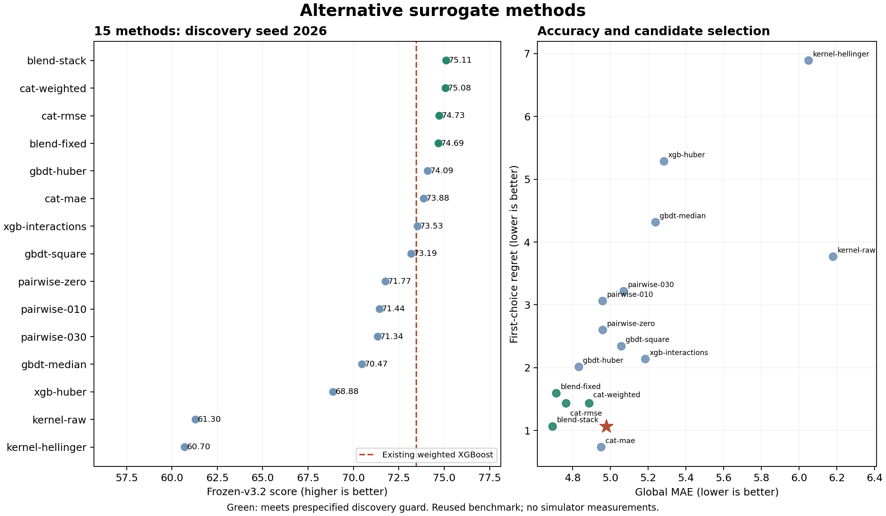

# Alternative-method study and handoff — 2026-10-29

Recommend the **training-only OOF convex ensemble** as the new surrogate recipe. It passes the
prespecified discovery guard and the matched model-seed audit. Its three-seed mean frozen-v3.2
score is **75.3591**, versus **73.1322** for the full-support step-weighted XGBoost reference.
Keep the existing operational controller in `recommended_weights.json`; the newly discovered
`study_weights.json` is exploratory and has no measured simulator score.

## Scope and evidence

Role C continued on `azq` at the user's request. Model extensions and the CatBoost dependency are
necessary changes outside C's usual optimizer paths. Shared interfaces, original models, frozen
splits, scoring policies, course files and main were preserved. The [prespecified protocol](../README.md)
was committed at `076b75f` before discovery. All 60 discovery CLI runs record that clean commit;
four seed-audit evaluations record clean commit `8c39898` (plotting added, model code identical).
The analysis output also records clean `8c39898` and exact input hashes in `provenance.json`.

Fifteen fixed recipes each have one frozen-v32 evaluation, one all-data training run and two
trust-dirichlet searches (optimizer seeds 2026/2027, 50 proposals each, risk=1, radius=.75).
No discovery failures occurred. The existing ten outer splits, two repeats of five folds, and
v3.2 scorer are unchanged. All label-dependent transformations, sample-weight thresholds, kernel
bandwidths and ensemble fitting use the current training partition only. Learned blend weights
use three-fold OOF predictions inside each outer training set. Every training row is retained.

## Discovery results — model seed 2026

Reference: `20261029-160333-evaluate-soft-xgboost-step-2026`, score 73.4746, global MAE 4.9765,
low MAE 6.6331, first-choice regret 1.0653. Exact run IDs for every row are in
`model_scores.csv`, `discovery_manifest.json` and `run_evidence.json`.

| Method | v3.2 ↑ | Global MAE ↓ | Low MAE ↓ | Top1 regret ↓ | Guard |
|---|---:|---:|---:|---:|---|
| blend-stack | 75.1137 | 4.6933 | 6.3988 | 1.0632 | pass |
| cat-weighted | 75.0766 | 4.8871 | 6.2727 | 1.4321 | pass |
| cat-rmse | 74.7311 | 4.7647 | 6.9232 | 1.4321 | pass |
| blend-fixed | 74.6869 | 4.7127 | 6.4510 | 1.5924 | pass |
| gbdt-huber | 74.0931 | 4.8324 | 6.5906 | 2.0125 | fail |
| cat-mae | 73.8765 | 4.9505 | 6.9884 | 0.7350 | fail |
| xgb-interactions | 73.5312 | 5.1844 | 6.6586 | 2.1373 | fail |
| gbdt-square | 73.1880 | 5.0575 | 6.8279 | 2.3415 | fail |
| pairwise-zero | 71.7669 | 4.9589 | 7.1449 | 2.6003 | fail |
| pairwise-010 | 71.4419 | 4.9581 | 6.7980 | 3.0611 | fail |
| pairwise-030 | 71.3396 | 5.0703 | 6.6833 | 3.2170 | fail |
| gbdt-median | 70.4740 | 5.2389 | 7.3425 | 4.3155 | fail |
| xgb-huber | 68.8756 | 5.2835 | 7.3232 | 5.2855 | fail |
| kernel-raw | 61.2984 | 6.1795 | 9.0959 | 3.7671 | fail |
| kernel-hellinger | 60.7009 | 6.0496 | 9.2450 | 6.8909 | fail |



Discovery guards require score >= reference+.5, global and low MAE <=1.05x reference,
regret <=2 and empirical proxy coverage .55–.80. Four recipes qualify; the highest score,
`blend-stack`, was frozen before the audit. Weighted CatBoost is only .0371 behind it at discovery,
so no stable head-to-head advantage over CatBoost is established. Uniform CatBoost also performs
well. Different tree construction and regularization, and complementary errors across three tree
families, are plausible reasons to pursue them; the study does not isolate these mechanisms causally.

Huber GBDT improves score but narrowly misses the regret guard. CatBoost MAE has the lowest
single-seed regret but insufficient total-score improvement. Explicit interactions yield little
improvement over the reference. Pairwise penalties .1/.3 underperform their zero-strength control;
there is no evidence to prefer this pair sampling/objective. Raw and Hellinger RBF kernels perform
poorly at the tested bandwidth/regularization. These are conclusions about the tested recipes,
not universal statements about each algorithm family.

## Frozen selection followed by matched seed audit

Only the selected stack and reference were audited at model seeds 2027/2028; no reselection followed.

| Model seed | Stack score | Reference score | Stack MAE | Reference MAE | Stack regret | Reference regret |
|---|---:|---:|---:|---:|---:|---:|
| 2026 | 75.1137 | 73.4746 | 4.6933 | 4.9765 | 1.0632 | 1.0653 |
| 2027 | 74.0689 | 72.7679 | 4.7177 | 5.0081 | 2.0084 | 1.8593 |
| 2028 | 76.8946 | 73.1540 | 4.6833 | 4.9597 | 0.2518 | 2.2295 |

The stack's mean score improves by **2.2269**; MAE ratios are .9431/.9420/.9443, all below 1.05.
Average regret falls from **1.7181 to 1.1078**. The prespecified replacement gate therefore passes
(`audit_decision.json`). The seed-2027 stack regret is slightly worse than the reference; the gate
constrains average regret, not every seed's regret. These seeds reuse the same records and splits.
They assess model sensitivity, not independent generalization or statistical significance.

At discovery, the stack improves on the reference in eight of ten outer folds; mean score gains
are +1.4418 and +1.8363 in the two repeats. Two folds regress, so the improvement is not uniform.
Distance-third diagnostics also expose the remaining extrapolation problem: the stack's MAE is
2.9775 / 4.3895 / 6.7263 for near / middle / far test rows relative to each fold's training data.
Far-third low-target MAE is 8.1229. These are within-fold distance thirds, not fresh distribution
shifts; low-target bins average only about six to eight rows per fold. `distance_summary.csv` is
the unweighted per-fold average of `distance_diagnostics.csv`; it supports retaining the trust radius.

The discovery score 75.1137 is descriptively above the previously recorded other-branch best 74.7167.
The audit seed-2028 score 76.8946 is a sensitivity result, **not a newly selected winning seed**.
Retain seed 2026 for the recommended full-data model. Broad reuse of this benchmark introduces
selection bias; none of these figures establishes independent SOTA or improvement in real R.

## Recommended model parameters

Use [`experiments/method-blend-stack.toml`](../../../experiments/method-blend-stack.toml), plugin
`method-study`, family `ensemble`, mode `stack`, iterations=600, seed=2026, calibration folds=3.
The full plugin defaults and native fitted-estimator parameters are archived in `parameters.json`.

- XGBoost: histogram squared-error regression, 600 trees, depth=3, learning_rate=.1,
  subsample=.9, n_jobs=1, low20 sample weights x3.
- CatBoost 1.2.8: RMSE, 600 trees, depth=5, learning_rate=.05, l2_leaf_reg=5, border_count=128,
  Bayesian bootstrap, bagging_temperature=1, random_strength=1, thread_count=1, low20 x3.
- HistGradientBoosting: squared error, max_iter=600, learning_rate=.05, max_leaf_nodes=15,
  uniform sample weights, sklearn 1.2.2 defaults otherwise.
- Meta-fit: three shuffled training-only folds, low20-x3 weighted MSE divided by training-target
  variance, nonnegative sum-one weights, .02 squared-distance regularization toward [.5,.3,.2].
  Each member refits on the entire current training partition after meta-fitting.
- Residual proxy: training-fold absolute errors, four distance bins, quantile=.68. Stack weights
  reuse those OOF labels, so the proxy is selection-aware and has no formal coverage guarantee.
  Outer coverage is .7036/.6953/.6997 over the three seeds.

The seed-2026 all-data fit (`20261029-171251-train-method-blend-stack`) learns weights
**XGBoost .2920246172, CatBoost .4437867722, HistGB .2641886106**. These weights describe that
full-data fit only; the reported validation score belongs to the procedure that relearns weights
inside each outer training fold. Do not fix these weights globally and attribute the same score to it.

## Controller weights and candidate screening

`recommended_weights.json` is byte-identical to the previously recommended controller:
`20261029-125052-optimize-histgb-v32`, proposal 16, distance ratio .5410021. Original HistGB/XGBoost
predictions remain 108.9778/108.8717; ExtraTrees predicts125.2473. They are predictions only.

A fixed panel of original HistGB, original XGBoost, the discovery stack and weighted CatBoost
cross-scores 1500 proposals plus incumbent, prior challenger and best measured row, rounded to eight
decimals and deduplicated. Eligible points must be novel and within distance ratio .75.
Selection minimizes max(mean+proxy) across the four judges, retaining the incumbent as selectable.
The panel contains the two highest discovery-scoring new methods; it was not independently validated.

The exploratory winner is **proposal 6** from
`20261029-171333-optimize-method-cat-weighted-search2026`, distance ratio **.6450312**:

| Judge | Mean | Error proxy |
|---|---:|---:|
| Original HistGB | 113.6136 | 3.3600 |
| Original XGBoost | 112.5709 | 3.4436 |
| New OOF stack | 112.8046 | 3.4420 |
| Weighted CatBoost | 112.4769 | 3.8928 |
| ExtraTrees (diagnostic) | 124.5457 | 7.1569 |

Within this panel, max(mean+proxy) improves from incumbent **119.9333** to **116.9736**.
This panel differs from prior studies, so its risk values cannot be compared directly to theirs.
There is no separately seeded candidate audit and ExtraTrees still dissents. The model audit does
not validate a searched controller; **do not replace the operational W on this evidence alone**.
`study_weights.json`, `candidate_selection.json`, all candidate weights and all cross-predictions
are retained. Building order and seven objective columns follow `sdm.simplex.FEATURES`.

## Verification and reproduction

Environment: uv0.13.6, Python3.11.9, numpy1.24.4, sklearn1.2.2, XGBoost3.2.0, CatBoost1.2.8;
all dependencies are locked. Unset ROS's PYTHONPATH when using project commands.

- Full suite: **109 passed, 1 known xfailed** (unchanged PGD duplicate-batch behavior).
- Discovery stack evaluation reproduced at `20261029-171901-evaluate-method-blend-stack`,
  matching outputs at rtol=1e-9.
- Selected source search reproduced at `20261029-172241-optimize-method-cat-weighted-search2026`,
  matching outputs at rtol=1e-9.
- `verification.json` records archive rescoring, strict JSON checks, simplex validation and CLI
  prediction agreement. `checksums.json` protects all delivered files other than itself.

From the repository root:

```bash
uv sync --locked --group gui
env -u PYTHONPATH uv run --locked --group gui pytest -q
env -u PYTHONPATH uv run --locked --group gui python analysis/method_expansion/verify_delivery.py
sh analysis/method_expansion/delivery/reproduce.sh analysis/method_expansion/results/recheck-methods
```

The verification script's archive mode works in a fresh clone; add `--with-local-models` to compare
exported weights against the original local fitted models through CLI predictions. `reproduce.sh`
requires the original local reference runs (listed in the script); it creates fresh discovery,
screening and audit directories and never overwrites the delivery. A fresh clone contains configs,
compressed outer predictions (15 discovery, four audit, one reference), metadata, metrics, candidate
weights and provenance, **not** ignored fitted model binaries or raw run directories. Recreate prior
reference runs from their configs in `run_evidence.json`, then substitute their new IDs in
`summarize.py` before running the complete workflow on a new machine.

## Next evidence to obtain

Prefer a fresh locked outer test or new real-evaluator observations before more benchmark-driven
selection. When a real-evaluator budget is available, compare incumbent and exploratory W with the
same evaluator version and record measured R. Weighted CatBoost is a useful cheaper contender for a
future prespecified audit; its discovery score alone is insufficient to replace the audited stack.
