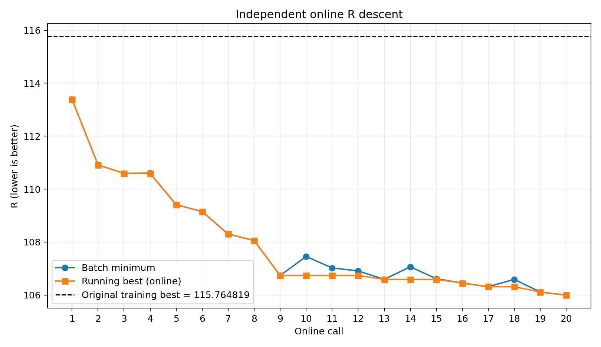
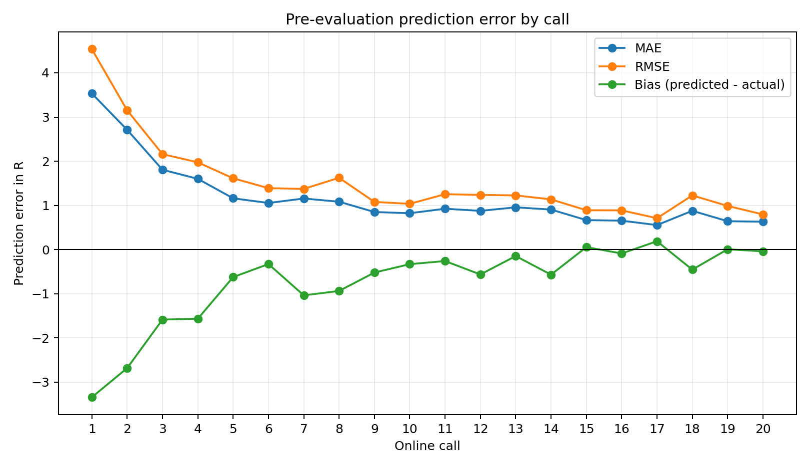
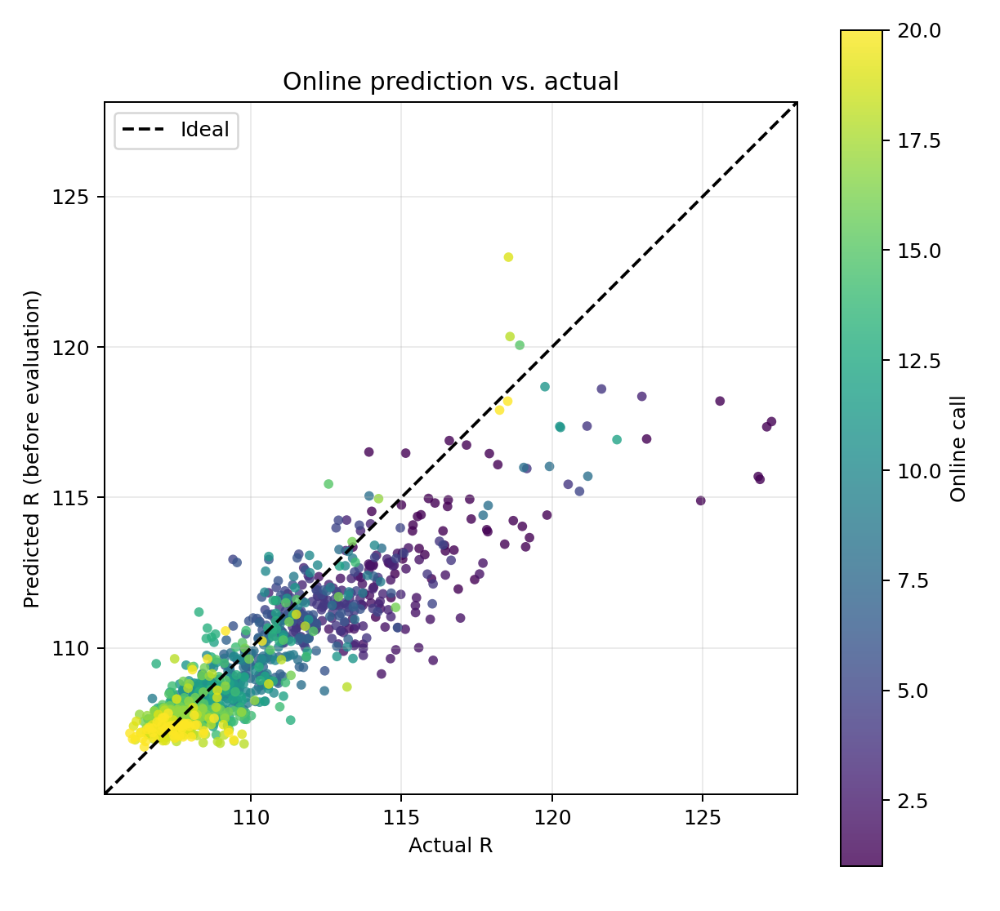

# Independent Online Surrogate-Model Validation: 20 Rounds × 50 Points

**Result:** using only the original 2,048 training rows and no prior search artefact, an additive ARD
Gaussian-process surrogate reduced the best measured R from the training-table best **115.7648** to
**105.9905**, an **8.44%** improvement, over 20 development batches and 1,000 real evaluations.

---

## 1. Question and independence constraints

Earlier local searches (ridge, evolution strategies, random search, trust-region perturbations, and
others) refined weights near already known good points. Their candidate generation, tuning, and success
criteria could therefore have been influenced by known low-R regions, making it difficult to distinguish
a genuinely useful model from one that had indirectly seen the answer.

This experiment imposed an independent starting point:

- read only the 2,048 original rows in `data/train.csv`;
- do not use `best_weights*.json`, `landscape_bundle`, or any earlier search result as a seed, template,
  structural prior, tuning input, or plotted reference;
- use only `115.76481925917324`, computed from the training table, as the reference value;
- evaluate 50 points per round for exactly 20 script-configured rounds, without changing the budget in
  response to intermediate results.

The question is: **without prior knowledge of the low-R region, can a surrogate with pointwise
uncertainty improve on the training-table best within 1,000 real evaluations, and by how much?**

---

## 2. Method

### 2.1 Surrogate: additive ARD Matérn-2.5 Gaussian process

The inputs are the original 21 weights (three buildings × seven objectives), with no derived features;
the target is the measured R. The kernel represents smooth within-building responses and approximate
additivity across buildings:

```text
K = 0.90 × mean(K_b1, K_b2, K_b3) + 0.10 × K_global
```

- Each `K_b` is a seven-dimensional Matérn-2.5 kernel for one building.
- `K_global` is a 21-dimensional Matérn-2.5 kernel providing a 10% interaction correction.
- The seven objective dimensions share ARD length scales across all three buildings: seven free length
  scales rather than 21.
- Initial length scale: 0.5, bounded by `[0.03, 3.0]`; initial white noise: 0.03, bounded by
  `[0.001, 0.3]`.
- L-BFGS-B uses at most 18 iterations, `ftol=1e-5`, one initial parameter vector, and no random restarts.

This model supplies posterior standard deviations directly, while shared length scales avoid fitting an
unconstrained high-dimensional kernel to 2,048 rows. Every round refits on all 2,048 training rows plus
all successful online observations so far, including poor observations.

### 2.2 Online uncertainty calibration

Raw GP extrapolation can be overconfident. The first round uses calibration coefficient `c = 1`.
Subsequent rounds use at most the 100 most recent online observations:

```text
c = clip(sqrt(mean((R_actual - mean_pred)^2 / std_raw^2)), 1.0, 3.0)
```

Selection uses `std = std_raw × c`. Both the raw and calibrated values are logged so that calibration
does not overwrite the original model output.

### 2.3 Candidates: multi-structure elites and whole-building replacement

Each round generates 24,000 candidates in two equal groups.

**(a) 12,000 multiscale local candidates**

- A structure is the triple of dominant objective indices, one per building, giving 343 possible triples.
- For every observed triple, the row with the lowest measured R is retained as its structure elite.
  Local search centres are the best 16 distinct structures.
- Each building is perturbed independently with a normalised Dirichlet distribution whose concentration
  is sampled uniformly from `{100, 300, 1000, 3000, 10000}`. Small values permit role changes; large
  values refine a narrow region.

**(b) 12,000 whole-building structure mutations**

- Select a base from the structure elites and replacement blocks from a low-R donor pool for the relevant
  building and dominant role, with at most eight donors per role.
- Replace one building with probability 0.8 and two buildings with probability 0.2; freeze every other
  building block exactly.
- Require the donor's dominant role to differ from the original block, so this operation searches for a
  whole-building role change rather than another small 21-dimensional perturbation.
- Sample the replacement fraction from `{0.5, 0.75, 1.0}`, then apply a small Dirichlet perturbation with
  concentration sampled from `{100, 300}` to each changed block.

The pool therefore contains both within-basin refinement and moves to different structural basins,
without assuming where those basins are.

### 2.4 Selecting each batch of 50 points

Three quotas use different acquisition functions and per-structure caps:

| Type | Acquisition (smaller is better) | Source | Structure cap | Purpose |
|---|---|---|---|---|
| `exploit` | `mean + 0.5·std` | Local candidates | 5 per triple | Conservative exploitation across several known basins |
| `structure` | `mean − 1.0·std` | Whole-building mutations | 1 per triple | Cross role-changing barriers |
| `explore` | `mean − 2.0·std` | All candidates at least `0.5·spacing` from the nearest observation | 2 per triple | Retain high-uncertainty opportunities |

- `spacing` is the median nearest-neighbour Euclidean distance across all current observations.
- Within each type, candidates are selected greedily by acquisition, subject to a distance of at least
  `0.1·spacing` from already selected points. This threshold is reduced only if quotas cannot be filled.
- Quotas are 15/25/10 in round 1. In rounds 2–20 they are 30/10/10 if a new global best appeared in the
  previous three batches, and 20/20/10 otherwise.
- Improvement is determined only by measured R, never by predictions.
- Deduplication covers training rows, every point already sent (including failed batches), and points in
  the current batch. `max|Δw| ≤ 1e-9` is a duplicate. If necessary, `structure` and then `exploit`
  candidates replenish the pool without relaxing legality checks.
- The master seed is 2026. Candidate streams derive from `default_rng([2026, call, stream_id])`.

The predicted minimum does not receive the whole batch because extrapolated GP minima are unreliable.
Fixed structure and uncertainty quotas distinguish this policy from pure exploitation.

---

## 3. Real-evaluation and transport protocol

- **Actual process:** each batch launched the extracted inner
  `RampingSolver.exe --serve --workers 4`. Each stdin line contained one flat 21-element JSON array;
  each JSON response line contained `{"R": <number>}`. The inner executable's SHA-256 was checked
  against the resource embedded in the course outer executable.
- **Outer executable:** `SolverEvaluator` computed the outer `solver.exe` SHA-256 but never launched it.
  Consequently, the outer program's `usage.count` was unchanged and played no role in this run.
- **Round limit:** 20 rounds was the script's own configuration, not consumption of a 20-call course
  quota. The outer solver's empty-stdin behaviour on this machine motivated the development transport.
- **Development only:** direct inner-solver JSON-lines transport must not be used for a formal run.
  Decision 31 requires the course `solver/run.py` procedure, in which PowerShell pipes `weight.json` to
  the outer `solver.exe`.
- **Conservative failure semantics:** once this script started a batch, it treated the batch as spent.
  Failed or timed-out points became sent-but-unmeasured and were never automatically resent. Resume
  stopped at an unresolved attempt unless `--accept-lost-attempt` explicitly marked it lost.
- All 20 development batches completed successfully; no batch was lost.

---

## 4. Results

### 4.1 Overview

| Metric | Value |
|---|---:|
| Successful development batches | 20 / 20 |
| Real evaluated points | 1,000 (all pairwise unique; no duplicate of the 2,048 training rows) |
| Best R | **105.9905449313** |
| Best location | Round 20, point 9 (`exploit`; dominant triple 5/6/5) |
| Training-table best R | 115.7648192592 |
| Relative improvement | 8.44% (9.774 lower) |
| Weight legality | Every building sums to 1; maximum error 7.8e-16 |
| Elapsed time | About 3 h 38 min (7.7–10.5 min per round) |







### 4.2 Round-by-round record

| Round | Training rows | Round minimum R | Cumulative online best | MAE | RMSE | 95% coverage |
|---:|---:|---:|---:|---:|---:|---:|
| 1 | 2048 | 113.388431 | 113.388431 | 3.533 | 4.536 | 0.94 |
| 2 | 2098 | 110.911043 | 110.911043 | 2.710 | 3.152 | 0.92 |
| 3 | 2148 | 110.592845 | 110.592845 | 1.806 | 2.160 | 0.98 |
| 4 | 2198 | 110.601818 | 110.592845 | 1.601 | 1.974 | 0.98 |
| 5 | 2248 | 109.411448 | 109.411448 | 1.161 | 1.613 | 1.00 |
| 6 | 2298 | 109.151150 | 109.151150 | 1.054 | 1.390 | 1.00 |
| 7 | 2348 | 108.300586 | 108.300586 | 1.156 | 1.374 | 0.98 |
| 8 | 2398 | 108.056657 | 108.056657 | 1.083 | 1.624 | 0.98 |
| 9 | 2448 | **106.733705** | 106.733705 | 0.850 | 1.078 | 0.96 |
| 10 | 2498 | 107.453859 | 106.733705 | 0.822 | 1.036 | 0.98 |
| 11 | 2548 | 107.018715 | 106.733705 | 0.924 | 1.254 | 0.98 |
| 12 | 2598 | 106.909122 | 106.733705 | 0.876 | 1.237 | 0.98 |
| 13 | 2648 | 106.588096 | 106.588096 | 0.956 | 1.226 | 0.98 |
| 14 | 2698 | 107.064135 | 106.588096 | 0.905 | 1.136 | 0.96 |
| 15 | 2748 | 106.613664 | 106.588096 | 0.667 | 0.890 | 0.98 |
| 16 | 2798 | 106.448603 | 106.448603 | 0.654 | 0.888 | 1.00 |
| 17 | 2848 | 106.309922 | 106.309922 | 0.554 | 0.710 | 1.00 |
| 18 | 2898 | 106.587310 | 106.309922 | 0.877 | 1.226 | 0.92 |
| 19 | 2948 | 106.109948 | 106.309922 | 0.642 | 0.987 | 0.96 |
| 20 | 2998 | **105.990545** | **105.990545** | 0.630 | 0.796 | 0.96 |

### 4.3 Interpretation

**Convergence:** R fell from 113.39 to 108.06 in eight rounds, then entered a plateau with occasional
improvements: 106.73 → 106.59 → 106.45 → 106.31 → 106.11 → 105.99. Round minima oscillated around
106–107 while the cumulative best continued to decline slowly, consistent with refinement within a basin.

**The ten best points are tightly clustered:** 105.991, 106.079, 106.110, 106.163, 106.181, 106.204,
106.310, 106.341, 106.356, and 106.409. The final rounds converged on the same low-value basin.

**Contributions by quota:**
- `exploit`: minimum 105.991, including the final best point;
- `structure`: minimum 106.110, showing that whole-building role changes reached a distinct competitive
  region;
- `explore`: minimum 106.514, supplying new regions for subsequent refinement although it did not produce
  the overall best.

**Prediction quality:** MAE fell from 3.53 to 0.63 and RMSE from 4.54 to 0.80; bias moved from −3.34 to
approximately zero. Early GP predictions systematically overestimated R, and online observations
corrected this. Coverage remained between 0.92 and 1.00, so the calibrated intervals were neither
severely too narrow nor excessively wide.

**Ranking:** Spearman correlation varied from 0.14 to 0.76 and was much weaker than numerical accuracy.
The model estimated approximate point quality better than it ranked pairs of similarly good points,
which helps explain the slow late-stage improvement.

---

## 5. Reproduction

`README.md` is the machine-facing reproduction and verification contract. Replace the two solver path
placeholders in `config.json`, extract the inner executable as documented there, and verify both pinned
solver hashes. The training-table hash is checked before the run.

```bash
python -m unittest -v test_validation.py
python run_online.py --synthetic
python run_online.py --dry-run --run-id check
python run_online.py --run-id independent_gp_2026
python plot_results.py independent_gp_2026
```

The direct inner transport is development-only. Do not use these commands as a substitute for the formal
course `solver/run.py` procedure required by decision 31.

---

## 6. Limitations

1. **No formal-run validation.** This experiment used the development-only inner transport. It does not
   validate the outer solver's stdin channel or consume the formal course quota.
2. **One 20-round script budget.** The curve was still declining at the end, but no additional rounds were
   run, so further improvement is not established.
3. **Weak fine-grained ranking.** Unreliable ordering among similarly good points is a likely cause of the
   slow late-stage progress.
4. **One random seed.** Only the trajectory from master seed 2026 was run. The result does not estimate
   seed-to-seed variance or establish superiority over another strategy.
5. **Coarse structure definition.** A dominant triple retains only each building's largest weight and
   ignores near ties; a finer structural representation might improve cross-basin search.

The separately archived local import containing R = 103.46086008194834 is unverified and was not an
input, tuning target, or reference line for this independent run. It is not an established team or
historical best, and this report makes no comparison against it.

---

## 7. Conclusion

Without using earlier search results, the additive ARD Matérn-2.5 GP, multi-structure elite candidates,
and mixed selection quotas reduced R from the training-table best 115.7648 to **105.9905449313** in 20
successful development batches and 1,000 real evaluations. The run is seeded and structurally verifiable,
with complete logs and no failed batches.

The supported conclusion is that this is an independently seeded, effective optimisation path with no
prior-search input. It is not evidence that the strategy is superior to other methods, nor that the
development transport is suitable for a formal run. Its main observed modelling bottleneck is ranking
among similarly strong candidates rather than numerical prediction error.
